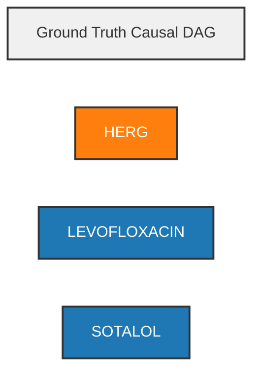

# MechanismTrace-DDI: Causal DAG Diff Visualizations

Model: `nousresearch/hermes-4-405b`
Generated: 2026-11-07

## Color Legend
- 🔵 **Blue**: Drug / Compound
- 🟠 **Orange**: Enzyme / Transporter / Target
- 🟣 **Purple**: Exposure / PK Change
- 🔴 **Red**: Clinical Risk / Outcome
- 🟢 **Green**: Patient Modifier / Physiological State

## Edge Styles
- **Solid**: Normal predicted edge
- **Dashed Red**: Spurious / Hallucinated edge (False Positive)
- *Note: Missing edges (False Negatives) only shown in Gold Standard*

---

## TASK-01: Dual Elimination Shutdown: Rivaroxaban + Ketoconazole in Moderate Renal Impairment

### Gold Standard (Ground Truth)
```mermaid
flowchart LR
    title["Ground Truth Causal DAG"]
    style title fill:#f0f0f0,stroke:#333,stroke-width:2px
    CYP3A4["CYP3A4"]
    style CYP3A4 fill:#ff7f0e,stroke:#333,stroke-width:2px,color:#fff
    KETOCONAZOLE["KETOCONAZOLE"]
    style KETOCONAZOLE fill:#1f77b4,stroke:#333,stroke-width:2px,color:#fff
    P_GP["P-GP"]
    style P_GP fill:#ff7f0e,stroke:#333,stroke-width:2px,color:#fff
    RIVAROXABAN["RIVAROXABAN"]
    style RIVAROXABAN fill:#1f77b4,stroke:#333,stroke-width:2px,color:#fff
    KETOCONAZOLE -->|INHIBITS| CYP3A4
    style KETOCONAZOLE --> CYP3A4 stroke:#2ca02c,stroke-width:3px
    KETOCONAZOLE -->|INHIBITS| P_GP
    style KETOCONAZOLE --> P_GP stroke:#2ca02c,stroke-width:3px
```

### Model Prediction
```mermaid
flowchart LR
    title["Predicted Causal DAG"]
    style title fill:#f0f0f0,stroke:#333,stroke-width:2px
    CYP3A4["CYP3A4"]
    style CYP3A4 fill:#ff7f0e,stroke:#333,stroke-width:2px,color:#fff
    KETOCONAZOLE["KETOCONAZOLE"]
    style KETOCONAZOLE fill:#1f77b4,stroke:#333,stroke-width:2px,color:#fff
    MODERATE_RENAL_IMPAIRMENT["MODERATE RENAL IMPAIRMENT"]
    style MODERATE_RENAL_IMPAIRMENT fill:#7f7f7f,stroke:#333,stroke-width:2px,color:#fff
    P_GP["P-GP"]
    style P_GP fill:#ff7f0e,stroke:#333,stroke-width:2px,color:#fff
    RIVAROXABAN["RIVAROXABAN"]
    style RIVAROXABAN fill:#1f77b4,stroke:#333,stroke-width:2px,color:#fff
    KETOCONAZOLE -->|INHIBITS| CYP3A4
    style KETOCONAZOLE --> CYP3A4 stroke:#2ca02c,stroke-width:3px
    KETOCONAZOLE -->|INHIBITS| P_GP
    style KETOCONAZOLE --> P_GP stroke:#2ca02c,stroke-width:3px
    KETOCONAZOLE -.->|INCREASES_EXPOSURE| RIVAROXABAN
    style KETOCONAZOLE -.-> RIVAROXABAN stroke:#d62728,stroke-width:2px,stroke-dasharray: 5 5
    MODERATE_RENAL_IMPAIRMENT -.->|INCREASES_EXPOSURE| RIVAROXABAN
    style MODERATE_RENAL_IMPAIRMENT -.-> RIVAROXABAN stroke:#d62728,stroke-width:2px,stroke-dasharray: 5 5
```

### Edge Comparison Summary
- **Matched**: 2 edges
- **Missing (False Negatives)**: 2 edges
  - CYP3A4 --INCREASES_EXPOSURE--> RIVAROXABAN
  - P-GP --INCREASES_EXPOSURE--> RIVAROXABAN
- **Spurious/Hallucinated (False Positives)**: 2 edges
  - KETOCONAZOLE --INCREASES_EXPOSURE--> RIVAROXABAN
  - MODERATE RENAL IMPAIRMENT --INCREASES_EXPOSURE--> RIVAROXABAN

---

## TASK-02: Prodrug Bioactivation Defeat: Clopidogrel + Omeprazole with Unknown CYP2C19 Genotype

### Gold Standard (Ground Truth)
```mermaid
flowchart LR
    title["Ground Truth Causal DAG"]
    style title fill:#f0f0f0,stroke:#333,stroke-width:2px
    CLOPIDOGREL_ACTIVE_THIOL_METABOLITE["CLOPIDOGREL_ACTIVE_THIOL_METABOLITE"]
    style CLOPIDOGREL_ACTIVE_THIOL_METABOLITE fill:#1f77b4,stroke:#333,stroke-width:2px,color:#fff
    CYP2C19["CYP2C19"]
    style CYP2C19 fill:#ff7f0e,stroke:#333,stroke-width:2px,color:#fff
    OMEPRAZOLE["OMEPRAZOLE"]
    style OMEPRAZOLE fill:#1f77b4,stroke:#333,stroke-width:2px,color:#fff
    P2Y12["P2Y12"]
    style P2Y12 fill:#ff7f0e,stroke:#333,stroke-width:2px,color:#fff
    OMEPRAZOLE -->|INHIBITS| CYP2C19
    style OMEPRAZOLE --> CYP2C19 stroke:#2ca02c,stroke-width:3px
```

### Model Prediction
```mermaid
flowchart LR
    title["Predicted Causal DAG"]
    style title fill:#f0f0f0,stroke:#333,stroke-width:2px
    CLOPIDOGREL["CLOPIDOGREL"]
    style CLOPIDOGREL fill:#1f77b4,stroke:#333,stroke-width:2px,color:#fff
    CYP2C19["CYP2C19"]
    style CYP2C19 fill:#ff7f0e,stroke:#333,stroke-width:2px,color:#fff
    OMEPRAZOLE["OMEPRAZOLE"]
    style OMEPRAZOLE fill:#1f77b4,stroke:#333,stroke-width:2px,color:#fff
    PANTOPRAZOLE["PANTOPRAZOLE"]
    style PANTOPRAZOLE fill:#1f77b4,stroke:#333,stroke-width:2px,color:#fff
    OMEPRAZOLE -->|INHIBITS| CYP2C19
    style OMEPRAZOLE --> CYP2C19 stroke:#2ca02c,stroke-width:3px
    CYP2C19 -.->|BLOCKS_BIOACTIVATION| CLOPIDOGREL
    style CYP2C19 -.-> CLOPIDOGREL stroke:#d62728,stroke-width:2px,stroke-dasharray: 5 5
    OMEPRAZOLE -.->|DECREASES_EXPOSURE| CLOPIDOGREL
    style OMEPRAZOLE -.-> CLOPIDOGREL stroke:#d62728,stroke-width:2px,stroke-dasharray: 5 5
    PANTOPRAZOLE -.->|INHIBITS| CYP2C19
    style PANTOPRAZOLE -.-> CYP2C19 stroke:#d62728,stroke-width:2px,stroke-dasharray: 5 5
    PANTOPRAZOLE -.->|DECREASES_EXPOSURE| CLOPIDOGREL
    style PANTOPRAZOLE -.-> CLOPIDOGREL stroke:#d62728,stroke-width:2px,stroke-dasharray: 5 5
```

### Edge Comparison Summary
- **Matched**: 1 edges
- **Missing (False Negatives)**: 2 edges
  - CLOPIDOGREL_ACTIVE_THIOL_METABOLITE --INHIBITS--> P2Y12
  - CYP2C19 --REQUIRES_FOR_BIOACTIVATION--> CLOPIDOGREL_ACTIVE_THIOL_METABOLITE
- **Spurious/Hallucinated (False Positives)**: 4 edges
  - CYP2C19 --BLOCKS_BIOACTIVATION--> CLOPIDOGREL
  - OMEPRAZOLE --DECREASES_EXPOSURE--> CLOPIDOGREL
  - PANTOPRAZOLE --DECREASES_EXPOSURE--> CLOPIDOGREL
  - PANTOPRAZOLE --INHIBITS--> CYP2C19

---

## TASK-03: Electrolyte-Gated Proarrhythmic Cascade: Sotalol + HCTZ + Levofloxacin

### Gold Standard (Ground Truth)


### Model Prediction
```mermaid
flowchart LR
    title["Predicted Causal DAG"]
    style title fill:#f0f0f0,stroke:#333,stroke-width:2px
    HERG_CHANNEL["HERG_CHANNEL"]
    style HERG_CHANNEL fill:#ff7f0e,stroke:#333,stroke-width:2px,color:#fff
    HYDROCHLOROTHIAZIDE["HYDROCHLOROTHIAZIDE"]
    style HYDROCHLOROTHIAZIDE fill:#7f7f7f,stroke:#333,stroke-width:2px,color:#fff
    HYPOKALEMIA["HYPOKALEMIA"]
    style HYPOKALEMIA fill:#2ca02c,stroke:#333,stroke-width:2px,color:#fff
    LEVOFLOXACIN["LEVOFLOXACIN"]
    style LEVOFLOXACIN fill:#1f77b4,stroke:#333,stroke-width:2px,color:#fff
    SERUM_POTASSIUM["SERUM_POTASSIUM"]
    style SERUM_POTASSIUM fill:#ff7f0e,stroke:#333,stroke-width:2px,color:#fff
    SOTALOL["SOTALOL"]
    style SOTALOL fill:#1f77b4,stroke:#333,stroke-width:2px,color:#fff
    HYDROCHLOROTHIAZIDE -.->|DECREASES_EXPOSURE| SERUM_POTASSIUM
    style HYDROCHLOROTHIAZIDE -.-> SERUM_POTASSIUM stroke:#d62728,stroke-width:2px,stroke-dasharray: 5 5
    HYPOKALEMIA -.->|INCREASES_EXPOSURE| HERG_CHANNEL
    style HYPOKALEMIA -.-> HERG_CHANNEL stroke:#d62728,stroke-width:2px,stroke-dasharray: 5 5
    SOTALOL -.->|BLOCKS_BIOACTIVATION| HERG_CHANNEL
    style SOTALOL -.-> HERG_CHANNEL stroke:#d62728,stroke-width:2px,stroke-dasharray: 5 5
    LEVOFLOXACIN -.->|COMPETITIVELY_BLOCKS| HERG_CHANNEL
    style LEVOFLOXACIN -.-> HERG_CHANNEL stroke:#d62728,stroke-width:2px,stroke-dasharray: 5 5
    HYPOKALEMIA -.->|INCREASES_EXPOSURE| SOTALOL
    style HYPOKALEMIA -.-> SOTALOL stroke:#d62728,stroke-width:2px,stroke-dasharray: 5 5
    HYPOKALEMIA -.->|INCREASES_EXPOSURE| LEVOFLOXACIN
    style HYPOKALEMIA -.-> LEVOFLOXACIN stroke:#d62728,stroke-width:2px,stroke-dasharray: 5 5
    SOTALOL -.->|PRODUCES_ADDITIVE_BLOCK| LEVOFLOXACIN
    style SOTALOL -.-> LEVOFLOXACIN stroke:#d62728,stroke-width:2px,stroke-dasharray: 5 5
```

### Edge Comparison Summary
- **Matched**: 0 edges
- **Missing (False Negatives)**: 2 edges
  - LEVOFLOXACIN --PRODUCES_ADDITIVE_BLOCK--> HERG
  - SOTALOL --INHIBITS--> HERG
- **Spurious/Hallucinated (False Positives)**: 7 edges
  - HYDROCHLOROTHIAZIDE --DECREASES_EXPOSURE--> SERUM_POTASSIUM
  - HYPOKALEMIA --INCREASES_EXPOSURE--> HERG_CHANNEL
  - HYPOKALEMIA --INCREASES_EXPOSURE--> LEVOFLOXACIN
  - HYPOKALEMIA --INCREASES_EXPOSURE--> SOTALOL
  - LEVOFLOXACIN --COMPETITIVELY_BLOCKS--> HERG_CHANNEL
  - SOTALOL --BLOCKS_BIOACTIVATION--> HERG_CHANNEL
  - SOTALOL --PRODUCES_ADDITIVE_BLOCK--> LEVOFLOXACIN

---
