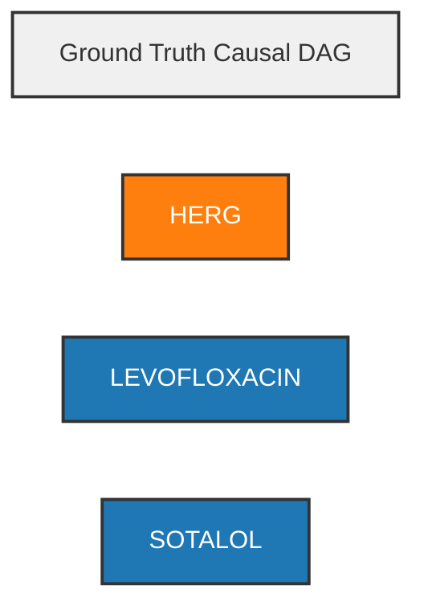
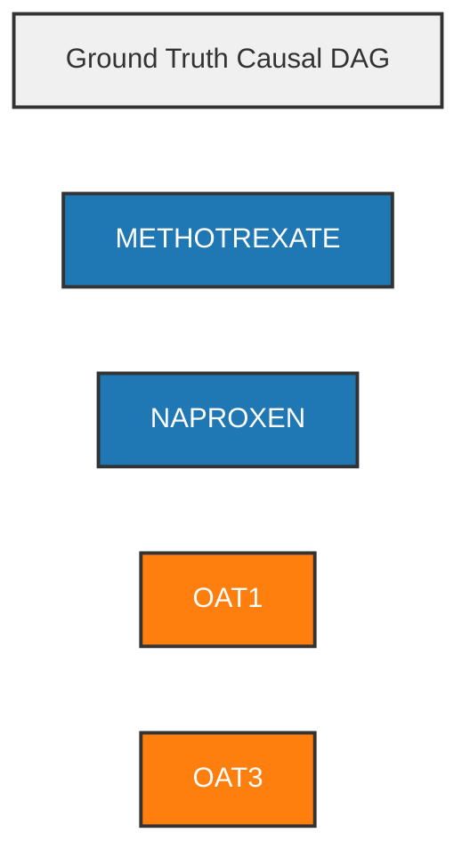
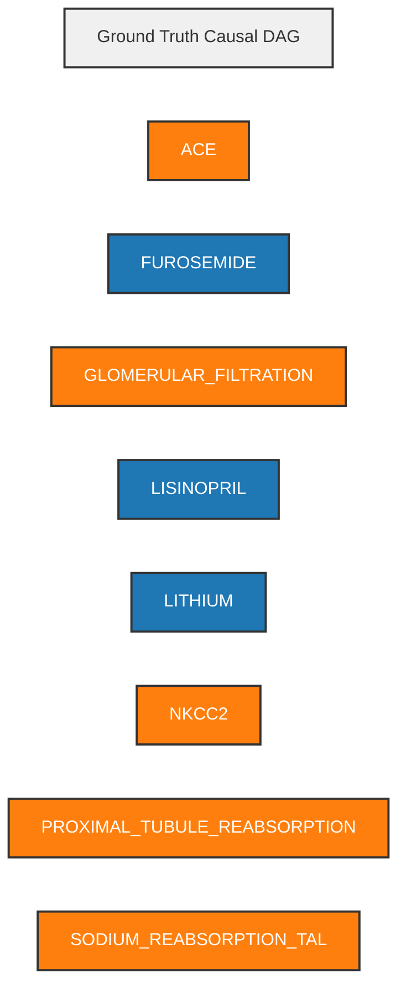
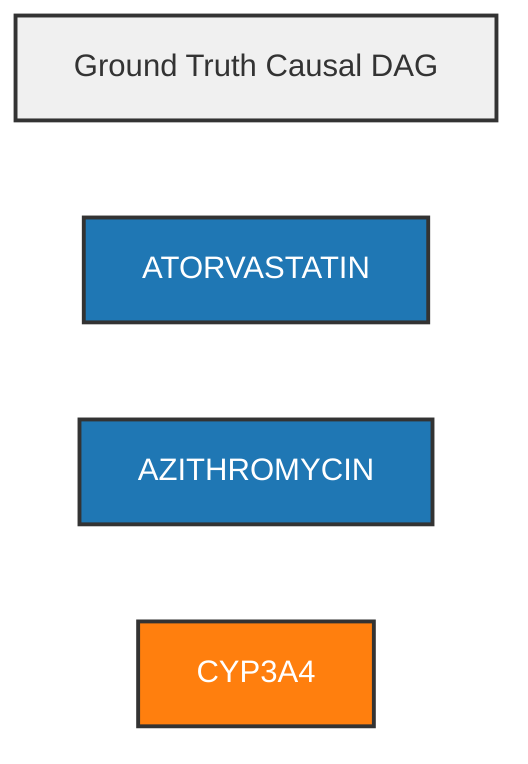
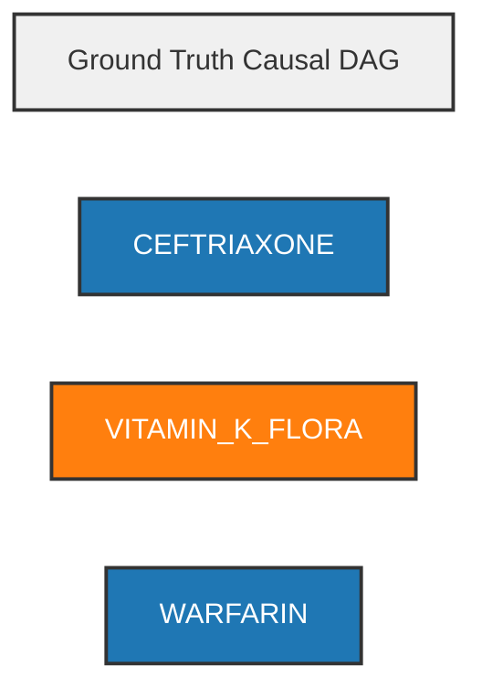

# MechanismTrace-DDI: Causal DAG Diff Visualizations

Model: `nousresearch/hermes-4-405b`
Generated: 2026-11-07

## Color Legend
- 🔵 **Blue**: Drug / Compound
- 🟠 **Orange**: Enzyme / Transporter / Target
- 🟣 **Purple**: Exposure / PK Change
- 🔴 **Red**: Clinical Risk / Outcome
- 🟢 **Green**: Patient Modifier / Physiological State

## Edge Styles
- **Solid**: Normal predicted edge
- **Dashed Red**: Spurious / Hallucinated edge (False Positive)
- *Note: Missing edges (False Negatives) only shown in Gold Standard*

---

## TASK-01: Dual Elimination Shutdown: Rivaroxaban + Ketoconazole in Moderate Renal Impairment

### Gold Standard (Ground Truth)
```mermaid
flowchart LR
    title["Ground Truth Causal DAG"]
    style title fill:#f0f0f0,stroke:#333,stroke-width:2px
    CYP3A4["CYP3A4"]
    style CYP3A4 fill:#ff7f0e,stroke:#333,stroke-width:2px,color:#fff
    KETOCONAZOLE["KETOCONAZOLE"]
    style KETOCONAZOLE fill:#1f77b4,stroke:#333,stroke-width:2px,color:#fff
    P_GP["P-GP"]
    style P_GP fill:#ff7f0e,stroke:#333,stroke-width:2px,color:#fff
    RIVAROXABAN["RIVAROXABAN"]
    style RIVAROXABAN fill:#1f77b4,stroke:#333,stroke-width:2px,color:#fff
    KETOCONAZOLE -->|INHIBITS| CYP3A4
    style KETOCONAZOLE --> CYP3A4 stroke:#2ca02c,stroke-width:3px
    KETOCONAZOLE -->|INHIBITS| P_GP
    style KETOCONAZOLE --> P_GP stroke:#2ca02c,stroke-width:3px
```

### Model Prediction
```mermaid
flowchart LR
    title["Predicted Causal DAG"]
    style title fill:#f0f0f0,stroke:#333,stroke-width:2px
    CYP3A4["CYP3A4"]
    style CYP3A4 fill:#ff7f0e,stroke:#333,stroke-width:2px,color:#fff
    KETOCONAZOLE["KETOCONAZOLE"]
    style KETOCONAZOLE fill:#1f77b4,stroke:#333,stroke-width:2px,color:#fff
    MODERATE_RENAL_IMPAIRMENT["MODERATE RENAL IMPAIRMENT"]
    style MODERATE_RENAL_IMPAIRMENT fill:#7f7f7f,stroke:#333,stroke-width:2px,color:#fff
    P_GP["P-GP"]
    style P_GP fill:#ff7f0e,stroke:#333,stroke-width:2px,color:#fff
    RIVAROXABAN["RIVAROXABAN"]
    style RIVAROXABAN fill:#1f77b4,stroke:#333,stroke-width:2px,color:#fff
    KETOCONAZOLE -->|INHIBITS| CYP3A4
    style KETOCONAZOLE --> CYP3A4 stroke:#2ca02c,stroke-width:3px
    KETOCONAZOLE -->|INHIBITS| P_GP
    style KETOCONAZOLE --> P_GP stroke:#2ca02c,stroke-width:3px
    KETOCONAZOLE -.->|INCREASES_EXPOSURE| RIVAROXABAN
    style KETOCONAZOLE -.-> RIVAROXABAN stroke:#d62728,stroke-width:2px,stroke-dasharray: 5 5
    MODERATE_RENAL_IMPAIRMENT -.->|INCREASES_EXPOSURE| RIVAROXABAN
    style MODERATE_RENAL_IMPAIRMENT -.-> RIVAROXABAN stroke:#d62728,stroke-width:2px,stroke-dasharray: 5 5
```

### Edge Comparison Summary
- **Matched**: 2 edges
- **Missing (False Negatives)**: 2 edges
  - CYP3A4 --INCREASES_EXPOSURE--> RIVAROXABAN
  - P-GP --INCREASES_EXPOSURE--> RIVAROXABAN
- **Spurious/Hallucinated (False Positives)**: 2 edges
  - KETOCONAZOLE --INCREASES_EXPOSURE--> RIVAROXABAN
  - MODERATE RENAL IMPAIRMENT --INCREASES_EXPOSURE--> RIVAROXABAN

---

## TASK-02: Prodrug Bioactivation Defeat: Clopidogrel + Omeprazole with Unknown CYP2C19 Genotype

### Gold Standard (Ground Truth)
```mermaid
flowchart LR
    title["Ground Truth Causal DAG"]
    style title fill:#f0f0f0,stroke:#333,stroke-width:2px
    CLOPIDOGREL_ACTIVE_THIOL_METABOLITE["CLOPIDOGREL_ACTIVE_THIOL_METABOLITE"]
    style CLOPIDOGREL_ACTIVE_THIOL_METABOLITE fill:#1f77b4,stroke:#333,stroke-width:2px,color:#fff
    CYP2C19["CYP2C19"]
    style CYP2C19 fill:#ff7f0e,stroke:#333,stroke-width:2px,color:#fff
    OMEPRAZOLE["OMEPRAZOLE"]
    style OMEPRAZOLE fill:#1f77b4,stroke:#333,stroke-width:2px,color:#fff
    P2Y12["P2Y12"]
    style P2Y12 fill:#ff7f0e,stroke:#333,stroke-width:2px,color:#fff
    OMEPRAZOLE -->|INHIBITS| CYP2C19
    style OMEPRAZOLE --> CYP2C19 stroke:#2ca02c,stroke-width:3px
```

### Model Prediction
```mermaid
flowchart LR
    title["Predicted Causal DAG"]
    style title fill:#f0f0f0,stroke:#333,stroke-width:2px
    CLOPIDOGREL["CLOPIDOGREL"]
    style CLOPIDOGREL fill:#1f77b4,stroke:#333,stroke-width:2px,color:#fff
    CYP2C19["CYP2C19"]
    style CYP2C19 fill:#ff7f0e,stroke:#333,stroke-width:2px,color:#fff
    OMEPRAZOLE["OMEPRAZOLE"]
    style OMEPRAZOLE fill:#1f77b4,stroke:#333,stroke-width:2px,color:#fff
    PANTOPRAZOLE["PANTOPRAZOLE"]
    style PANTOPRAZOLE fill:#1f77b4,stroke:#333,stroke-width:2px,color:#fff
    OMEPRAZOLE -->|INHIBITS| CYP2C19
    style OMEPRAZOLE --> CYP2C19 stroke:#2ca02c,stroke-width:3px
    CYP2C19 -.->|BLOCKS_BIOACTIVATION| CLOPIDOGREL
    style CYP2C19 -.-> CLOPIDOGREL stroke:#d62728,stroke-width:2px,stroke-dasharray: 5 5
    OMEPRAZOLE -.->|DECREASES_EXPOSURE| CLOPIDOGREL
    style OMEPRAZOLE -.-> CLOPIDOGREL stroke:#d62728,stroke-width:2px,stroke-dasharray: 5 5
    PANTOPRAZOLE -.->|INHIBITS| CYP2C19
    style PANTOPRAZOLE -.-> CYP2C19 stroke:#d62728,stroke-width:2px,stroke-dasharray: 5 5
    PANTOPRAZOLE -.->|DECREASES_EXPOSURE| CLOPIDOGREL
    style PANTOPRAZOLE -.-> CLOPIDOGREL stroke:#d62728,stroke-width:2px,stroke-dasharray: 5 5
```

### Edge Comparison Summary
- **Matched**: 1 edges
- **Missing (False Negatives)**: 2 edges
  - CLOPIDOGREL_ACTIVE_THIOL_METABOLITE --INHIBITS--> P2Y12
  - CYP2C19 --REQUIRES_FOR_BIOACTIVATION--> CLOPIDOGREL_ACTIVE_THIOL_METABOLITE
- **Spurious/Hallucinated (False Positives)**: 4 edges
  - CYP2C19 --BLOCKS_BIOACTIVATION--> CLOPIDOGREL
  - OMEPRAZOLE --DECREASES_EXPOSURE--> CLOPIDOGREL
  - PANTOPRAZOLE --DECREASES_EXPOSURE--> CLOPIDOGREL
  - PANTOPRAZOLE --INHIBITS--> CYP2C19

---

## TASK-03: Electrolyte-Gated Proarrhythmic Cascade: Sotalol + HCTZ + Levofloxacin

### Gold Standard (Ground Truth)


### Model Prediction
```mermaid
flowchart LR
    title["Predicted Causal DAG"]
    style title fill:#f0f0f0,stroke:#333,stroke-width:2px
    HERG_CHANNEL["HERG_CHANNEL"]
    style HERG_CHANNEL fill:#ff7f0e,stroke:#333,stroke-width:2px,color:#fff
    HYDROCHLOROTHIAZIDE["HYDROCHLOROTHIAZIDE"]
    style HYDROCHLOROTHIAZIDE fill:#7f7f7f,stroke:#333,stroke-width:2px,color:#fff
    HYPOKALEMIA["HYPOKALEMIA"]
    style HYPOKALEMIA fill:#2ca02c,stroke:#333,stroke-width:2px,color:#fff
    LEVOFLOXACIN["LEVOFLOXACIN"]
    style LEVOFLOXACIN fill:#1f77b4,stroke:#333,stroke-width:2px,color:#fff
    SERUM_POTASSIUM["SERUM_POTASSIUM"]
    style SERUM_POTASSIUM fill:#ff7f0e,stroke:#333,stroke-width:2px,color:#fff
    SOTALOL["SOTALOL"]
    style SOTALOL fill:#1f77b4,stroke:#333,stroke-width:2px,color:#fff
    HYDROCHLOROTHIAZIDE -.->|DECREASES_EXPOSURE| SERUM_POTASSIUM
    style HYDROCHLOROTHIAZIDE -.-> SERUM_POTASSIUM stroke:#d62728,stroke-width:2px,stroke-dasharray: 5 5
    HYPOKALEMIA -.->|INCREASES_EXPOSURE| HERG_CHANNEL
    style HYPOKALEMIA -.-> HERG_CHANNEL stroke:#d62728,stroke-width:2px,stroke-dasharray: 5 5
    SOTALOL -.->|BLOCKS_BIOACTIVATION| HERG_CHANNEL
    style SOTALOL -.-> HERG_CHANNEL stroke:#d62728,stroke-width:2px,stroke-dasharray: 5 5
    LEVOFLOXACIN -.->|COMPETITIVELY_BLOCKS| HERG_CHANNEL
    style LEVOFLOXACIN -.-> HERG_CHANNEL stroke:#d62728,stroke-width:2px,stroke-dasharray: 5 5
    HYPOKALEMIA -.->|INCREASES_EXPOSURE| SOTALOL
    style HYPOKALEMIA -.-> SOTALOL stroke:#d62728,stroke-width:2px,stroke-dasharray: 5 5
    HYPOKALEMIA -.->|INCREASES_EXPOSURE| LEVOFLOXACIN
    style HYPOKALEMIA -.-> LEVOFLOXACIN stroke:#d62728,stroke-width:2px,stroke-dasharray: 5 5
    SOTALOL -.->|PRODUCES_ADDITIVE_BLOCK| LEVOFLOXACIN
    style SOTALOL -.-> LEVOFLOXACIN stroke:#d62728,stroke-width:2px,stroke-dasharray: 5 5
```

### Edge Comparison Summary
- **Matched**: 0 edges
- **Missing (False Negatives)**: 2 edges
  - LEVOFLOXACIN --PRODUCES_ADDITIVE_BLOCK--> HERG
  - SOTALOL --INHIBITS--> HERG
- **Spurious/Hallucinated (False Positives)**: 7 edges
  - HYDROCHLOROTHIAZIDE --DECREASES_EXPOSURE--> SERUM_POTASSIUM
  - HYPOKALEMIA --INCREASES_EXPOSURE--> HERG_CHANNEL
  - HYPOKALEMIA --INCREASES_EXPOSURE--> LEVOFLOXACIN
  - HYPOKALEMIA --INCREASES_EXPOSURE--> SOTALOL
  - LEVOFLOXACIN --COMPETITIVELY_BLOCKS--> HERG_CHANNEL
  - SOTALOL --BLOCKS_BIOACTIVATION--> HERG_CHANNEL
  - SOTALOL --PRODUCES_ADDITIVE_BLOCK--> LEVOFLOXACIN

---

## TASK-04: Renal Transporter Secretion Blockade: Methotrexate + Naproxen in Borderline Clearance

### Gold Standard (Ground Truth)


### Model Prediction
```mermaid
flowchart LR
    title["Predicted Causal DAG"]
    style title fill:#f0f0f0,stroke:#333,stroke-width:2px
    METHOTREXATE["METHOTREXATE"]
    style METHOTREXATE fill:#1f77b4,stroke:#333,stroke-width:2px,color:#fff
    NAPROXEN["NAPROXEN"]
    style NAPROXEN fill:#1f77b4,stroke:#333,stroke-width:2px,color:#fff
    OAT3["OAT3"]
    style OAT3 fill:#ff7f0e,stroke:#333,stroke-width:2px,color:#fff
    NAPROXEN -.->|INHIBITS| OAT3
    style NAPROXEN -.-> OAT3 stroke:#d62728,stroke-width:2px,stroke-dasharray: 5 5
    NAPROXEN -.->|INCREASES_EXPOSURE| METHOTREXATE
    style NAPROXEN -.-> METHOTREXATE stroke:#d62728,stroke-width:2px,stroke-dasharray: 5 5
    METHOTREXATE -.->|COMPETITIVELY_BLOCKS| OAT3
    style METHOTREXATE -.-> OAT3 stroke:#d62728,stroke-width:2px,stroke-dasharray: 5 5
```

### Edge Comparison Summary
- **Matched**: 0 edges
- **Missing (False Negatives)**: 4 edges
  - NAPROXEN --COMPETITIVELY_BLOCKS--> OAT1
  - NAPROXEN --COMPETITIVELY_BLOCKS--> OAT3
  - OAT1 --INCREASES_EXPOSURE--> METHOTREXATE
  - OAT3 --INCREASES_EXPOSURE--> METHOTREXATE
- **Spurious/Hallucinated (False Positives)**: 3 edges
  - METHOTREXATE --COMPETITIVELY_BLOCKS--> OAT3
  - NAPROXEN --INCREASES_EXPOSURE--> METHOTREXATE
  - NAPROXEN --INHIBITS--> OAT3

---

## TASK-05: Substrate Competition & Regulatory Dose Ceiling: Simvastatin + Amlodipine

### Gold Standard (Ground Truth)
```mermaid
flowchart LR
    title["Ground Truth Causal DAG"]
    style title fill:#f0f0f0,stroke:#333,stroke-width:2px
    AMLODIPINE["AMLODIPINE"]
    style AMLODIPINE fill:#1f77b4,stroke:#333,stroke-width:2px,color:#fff
    CYP3A4["CYP3A4"]
    style CYP3A4 fill:#ff7f0e,stroke:#333,stroke-width:2px,color:#fff
    SIMVASTATIN_ACID["SIMVASTATIN_ACID"]
    style SIMVASTATIN_ACID fill:#1f77b4,stroke:#333,stroke-width:2px,color:#fff
    SIMVASTATIN_LACTONE["SIMVASTATIN_LACTONE"]
    style SIMVASTATIN_LACTONE fill:#1f77b4,stroke:#333,stroke-width:2px,color:#fff
    AMLODIPINE -->|INHIBITS| CYP3A4
    style AMLODIPINE --> CYP3A4 stroke:#2ca02c,stroke-width:3px
```

### Model Prediction
```mermaid
flowchart LR
    title["Predicted Causal DAG"]
    style title fill:#f0f0f0,stroke:#333,stroke-width:2px
    AMLODIPINE["AMLODIPINE"]
    style AMLODIPINE fill:#1f77b4,stroke:#333,stroke-width:2px,color:#fff
    CYP3A4["CYP3A4"]
    style CYP3A4 fill:#ff7f0e,stroke:#333,stroke-width:2px,color:#fff
    SIMVASTATIN["SIMVASTATIN"]
    style SIMVASTATIN fill:#1f77b4,stroke:#333,stroke-width:2px,color:#fff
    AMLODIPINE -->|INHIBITS| CYP3A4
    style AMLODIPINE --> CYP3A4 stroke:#2ca02c,stroke-width:3px
    SIMVASTATIN -.->|COMPETITIVELY_BLOCKS| CYP3A4
    style SIMVASTATIN -.-> CYP3A4 stroke:#d62728,stroke-width:2px,stroke-dasharray: 5 5
    AMLODIPINE -.->|INCREASES_EXPOSURE| SIMVASTATIN
    style AMLODIPINE -.-> SIMVASTATIN stroke:#d62728,stroke-width:2px,stroke-dasharray: 5 5
```

### Edge Comparison Summary
- **Matched**: 1 edges
- **Missing (False Negatives)**: 2 edges
  - CYP3A4 --INCREASES_EXPOSURE--> SIMVASTATIN_LACTONE
  - SIMVASTATIN_LACTONE --INCREASES_EXPOSURE--> SIMVASTATIN_ACID
- **Spurious/Hallucinated (False Positives)**: 2 edges
  - AMLODIPINE --INCREASES_EXPOSURE--> SIMVASTATIN
  - SIMVASTATIN --COMPETITIVELY_BLOCKS--> CYP3A4

---

## TASK-06: CYP3A4/5 Multi-Enzyme Collapse: Tacrolimus + Voriconazole with CYP3A5*3/*3 Genotype

### Gold Standard (Ground Truth)
```mermaid
flowchart LR
    title["Ground Truth Causal DAG"]
    style title fill:#f0f0f0,stroke:#333,stroke-width:2px
    CYP3A4["CYP3A4"]
    style CYP3A4 fill:#ff7f0e,stroke:#333,stroke-width:2px,color:#fff
    TACROLIMUS["TACROLIMUS"]
    style TACROLIMUS fill:#1f77b4,stroke:#333,stroke-width:2px,color:#fff
    VORICONAZOLE["VORICONAZOLE"]
    style VORICONAZOLE fill:#1f77b4,stroke:#333,stroke-width:2px,color:#fff
    VORICONAZOLE -->|INHIBITS| CYP3A4
    style VORICONAZOLE --> CYP3A4 stroke:#2ca02c,stroke-width:3px
```

### Model Prediction
```mermaid
flowchart LR
    title["Predicted Causal DAG"]
    style title fill:#f0f0f0,stroke:#333,stroke-width:2px
    CYP2C19["CYP2C19"]
    style CYP2C19 fill:#ff7f0e,stroke:#333,stroke-width:2px,color:#fff
    CYP2C9["CYP2C9"]
    style CYP2C9 fill:#ff7f0e,stroke:#333,stroke-width:2px,color:#fff
    CYP3A4["CYP3A4"]
    style CYP3A4 fill:#ff7f0e,stroke:#333,stroke-width:2px,color:#fff
    CYP3A5_3__3_GENOTYPE["CYP3A5*3/*3 GENOTYPE"]
    style CYP3A5_3__3_GENOTYPE fill:#ff7f0e,stroke:#333,stroke-width:2px,color:#fff
    TACROLIMUS["TACROLIMUS"]
    style TACROLIMUS fill:#1f77b4,stroke:#333,stroke-width:2px,color:#fff
    TACROLIMUS_METABOLISM["TACROLIMUS METABOLISM"]
    style TACROLIMUS_METABOLISM fill:#1f77b4,stroke:#333,stroke-width:2px,color:#fff
    VORICONAZOLE["VORICONAZOLE"]
    style VORICONAZOLE fill:#1f77b4,stroke:#333,stroke-width:2px,color:#fff
    VORICONAZOLE -->|INHIBITS| CYP3A4
    style VORICONAZOLE --> CYP3A4 stroke:#2ca02c,stroke-width:3px
    VORICONAZOLE -.->|INHIBITS| CYP2C19
    style VORICONAZOLE -.-> CYP2C19 stroke:#d62728,stroke-width:2px,stroke-dasharray: 5 5
    VORICONAZOLE -.->|INHIBITS| CYP2C9
    style VORICONAZOLE -.-> CYP2C9 stroke:#d62728,stroke-width:2px,stroke-dasharray: 5 5
    VORICONAZOLE -.->|INCREASES_EXPOSURE| TACROLIMUS
    style VORICONAZOLE -.-> TACROLIMUS stroke:#d62728,stroke-width:2px,stroke-dasharray: 5 5
    CYP3A5_3__3_GENOTYPE -.->|DECREASES_EXPOSURE| TACROLIMUS_METABOLISM
    style CYP3A5_3__3_GENOTYPE -.-> TACROLIMUS_METABOLISM stroke:#d62728,stroke-width:2px,stroke-dasharray: 5 5
```

### Edge Comparison Summary
- **Matched**: 1 edges
- **Missing (False Negatives)**: 1 edges
  - CYP3A4 --INCREASES_EXPOSURE--> TACROLIMUS
- **Spurious/Hallucinated (False Positives)**: 4 edges
  - CYP3A5*3/*3 GENOTYPE --DECREASES_EXPOSURE--> TACROLIMUS METABOLISM
  - VORICONAZOLE --INCREASES_EXPOSURE--> TACROLIMUS
  - VORICONAZOLE --INHIBITS--> CYP2C19
  - VORICONAZOLE --INHIBITS--> CYP2C9

---

## TASK-07: Stereoselective Enantiomeric Clearance Blockade: Warfarin + Metronidazole

### Gold Standard (Ground Truth)
```mermaid
flowchart LR
    title["Ground Truth Causal DAG"]
    style title fill:#f0f0f0,stroke:#333,stroke-width:2px
    CYP2C9["CYP2C9"]
    style CYP2C9 fill:#ff7f0e,stroke:#333,stroke-width:2px,color:#fff
    CYP3A4["CYP3A4"]
    style CYP3A4 fill:#ff7f0e,stroke:#333,stroke-width:2px,color:#fff
    METRONIDAZOLE["METRONIDAZOLE"]
    style METRONIDAZOLE fill:#1f77b4,stroke:#333,stroke-width:2px,color:#fff
    R_WARFARIN["R-WARFARIN"]
    style R_WARFARIN fill:#1f77b4,stroke:#333,stroke-width:2px,color:#fff
    S_WARFARIN["S-WARFARIN"]
    style S_WARFARIN fill:#1f77b4,stroke:#333,stroke-width:2px,color:#fff
    METRONIDAZOLE -->|INHIBITS| CYP3A4
    style METRONIDAZOLE --> CYP3A4 stroke:#2ca02c,stroke-width:3px
```

### Model Prediction
```mermaid
flowchart LR
    title["Predicted Causal DAG"]
    style title fill:#f0f0f0,stroke:#333,stroke-width:2px
    CYP2C9["CYP2C9"]
    style CYP2C9 fill:#ff7f0e,stroke:#333,stroke-width:2px,color:#fff
    CYP2C9_INHIBITION["CYP2C9 INHIBITION"]
    style CYP2C9_INHIBITION fill:#ff7f0e,stroke:#333,stroke-width:2px,color:#fff
    CYP3A4["CYP3A4"]
    style CYP3A4 fill:#ff7f0e,stroke:#333,stroke-width:2px,color:#fff
    CYP3A4_INHIBITION["CYP3A4 INHIBITION"]
    style CYP3A4_INHIBITION fill:#ff7f0e,stroke:#333,stroke-width:2px,color:#fff
    INCREASED_S_WARFARIN_EXPOSURE["INCREASED S-WARFARIN EXPOSURE"]
    style INCREASED_S_WARFARIN_EXPOSURE fill:#1f77b4,stroke:#333,stroke-width:2px,color:#fff
    INR["INR"]
    style INR fill:#d62728,stroke:#333,stroke-width:2px,color:#fff
    METRONIDAZOLE["METRONIDAZOLE"]
    style METRONIDAZOLE fill:#1f77b4,stroke:#333,stroke-width:2px,color:#fff
    R_WARFARIN["R-WARFARIN"]
    style R_WARFARIN fill:#1f77b4,stroke:#333,stroke-width:2px,color:#fff
    S_WARFARIN["S-WARFARIN"]
    style S_WARFARIN fill:#1f77b4,stroke:#333,stroke-width:2px,color:#fff
    METRONIDAZOLE -.->|INHIBITS| CYP2C9
    style METRONIDAZOLE -.-> CYP2C9 stroke:#d62728,stroke-width:2px,stroke-dasharray: 5 5
    METRONIDAZOLE -->|INHIBITS| CYP3A4
    style METRONIDAZOLE --> CYP3A4 stroke:#2ca02c,stroke-width:3px
    CYP2C9_INHIBITION -.->|INCREASES_EXPOSURE| S_WARFARIN
    style CYP2C9_INHIBITION -.-> S_WARFARIN stroke:#d62728,stroke-width:2px,stroke-dasharray: 5 5
    CYP3A4_INHIBITION -.->|INCREASES_EXPOSURE| R_WARFARIN
    style CYP3A4_INHIBITION -.-> R_WARFARIN stroke:#d62728,stroke-width:2px,stroke-dasharray: 5 5
    INCREASED_S_WARFARIN_EXPOSURE -.->|INCREASES_EXPOSURE| INR
    style INCREASED_S_WARFARIN_EXPOSURE -.-> INR stroke:#d62728,stroke-width:2px,stroke-dasharray: 5 5
```

### Edge Comparison Summary
- **Matched**: 1 edges
- **Missing (False Negatives)**: 3 edges
  - CYP2C9 --INCREASES_EXPOSURE--> S-WARFARIN
  - CYP3A4 --INCREASES_EXPOSURE--> R-WARFARIN
  - METRONIDAZOLE --STEREOSELECTIVELY_INHIBITS--> CYP2C9
- **Spurious/Hallucinated (False Positives)**: 4 edges
  - CYP2C9 INHIBITION --INCREASES_EXPOSURE--> S-WARFARIN
  - CYP3A4 INHIBITION --INCREASES_EXPOSURE--> R-WARFARIN
  - INCREASED S-WARFARIN EXPOSURE --INCREASES_EXPOSURE--> INR
  - METRONIDAZOLE --INHIBITS--> CYP2C9

---

## TASK-08: Renal Proximal Tubule Sodium-Mimic Synergy: Lithium + Lisinopril + Furosemide

### Gold Standard (Ground Truth)


### Model Prediction
```mermaid
flowchart LR
    title["Predicted Causal DAG"]
    style title fill:#f0f0f0,stroke:#333,stroke-width:2px
    FUROSEMIDE["FUROSEMIDE"]
    style FUROSEMIDE fill:#1f77b4,stroke:#333,stroke-width:2px,color:#fff
    FUROSEMIDE___LISINOPRIL["FUROSEMIDE + LISINOPRIL"]
    style FUROSEMIDE___LISINOPRIL fill:#1f77b4,stroke:#333,stroke-width:2px,color:#fff
    LISINOPRIL["LISINOPRIL"]
    style LISINOPRIL fill:#1f77b4,stroke:#333,stroke-width:2px,color:#fff
    LITHIUM["LITHIUM"]
    style LITHIUM fill:#1f77b4,stroke:#333,stroke-width:2px,color:#fff
    LITHIUM_CLEARANCE["LITHIUM CLEARANCE"]
    style LITHIUM_CLEARANCE fill:#1f77b4,stroke:#333,stroke-width:2px,color:#fff
    PROXIMAL_TUBULE_SODIUM_REABSORPTION["PROXIMAL TUBULE SODIUM REABSORPTION"]
    style PROXIMAL_TUBULE_SODIUM_REABSORPTION fill:#7f7f7f,stroke:#333,stroke-width:2px,color:#fff
    RENAL_PERFUSION_PRESSURE["RENAL PERFUSION PRESSURE"]
    style RENAL_PERFUSION_PRESSURE fill:#7f7f7f,stroke:#333,stroke-width:2px,color:#fff
    SODIUM_CHANNEL_PROTEINS["SODIUM CHANNEL PROTEINS"]
    style SODIUM_CHANNEL_PROTEINS fill:#7f7f7f,stroke:#333,stroke-width:2px,color:#fff
    FUROSEMIDE -.->|INCREASES_EXPOSURE| PROXIMAL_TUBULE_SODIUM_REABSORPTION
    style FUROSEMIDE -.-> PROXIMAL_TUBULE_SODIUM_REABSORPTION stroke:#d62728,stroke-width:2px,stroke-dasharray: 5 5
    LISINOPRIL -.->|DECREASES_EXPOSURE| RENAL_PERFUSION_PRESSURE
    style LISINOPRIL -.-> RENAL_PERFUSION_PRESSURE stroke:#d62728,stroke-width:2px,stroke-dasharray: 5 5
    LISINOPRIL -.->|DECREASES_EXPOSURE| LITHIUM_CLEARANCE
    style LISINOPRIL -.-> LITHIUM_CLEARANCE stroke:#d62728,stroke-width:2px,stroke-dasharray: 5 5
    FUROSEMIDE___LISINOPRIL -.->|PRODUCES_ADDITIVE_BLOCK| LITHIUM
    style FUROSEMIDE___LISINOPRIL -.-> LITHIUM stroke:#d62728,stroke-width:2px,stroke-dasharray: 5 5
    LITHIUM -.->|COMPETITIVELY_BLOCKS| SODIUM_CHANNEL_PROTEINS
    style LITHIUM -.-> SODIUM_CHANNEL_PROTEINS stroke:#d62728,stroke-width:2px,stroke-dasharray: 5 5
```

### Edge Comparison Summary
- **Matched**: 0 edges
- **Missing (False Negatives)**: 7 edges
  - ACE --DECREASES_EXPOSURE--> GLOMERULAR_FILTRATION
  - FUROSEMIDE --INHIBITS--> NKCC2
  - GLOMERULAR_FILTRATION --INCREASES_EXPOSURE--> LITHIUM
  - LISINOPRIL --INHIBITS--> ACE
  - NKCC2 --DECREASES_EXPOSURE--> SODIUM_REABSORPTION_TAL
  - PROXIMAL_TUBULE_REABSORPTION --INCREASES_EXPOSURE--> LITHIUM
  - SODIUM_REABSORPTION_TAL --INDUCES--> PROXIMAL_TUBULE_REABSORPTION
- **Spurious/Hallucinated (False Positives)**: 5 edges
  - FUROSEMIDE --INCREASES_EXPOSURE--> PROXIMAL TUBULE SODIUM REABSORPTION
  - FUROSEMIDE + LISINOPRIL --PRODUCES_ADDITIVE_BLOCK--> LITHIUM
  - LISINOPRIL --DECREASES_EXPOSURE--> LITHIUM CLEARANCE
  - LISINOPRIL --DECREASES_EXPOSURE--> RENAL PERFUSION PRESSURE
  - LITHIUM --COMPETITIVELY_BLOCKS--> SODIUM CHANNEL PROTEINS

---

## TASK-09: Safe Combination Control: Atorvastatin + Azithromycin (No Clinically Meaningful CYP3A4 Inhibition)

### Gold Standard (Ground Truth)


### Model Prediction
```mermaid
flowchart LR
    title["Predicted Causal DAG"]
    style title fill:#f0f0f0,stroke:#333,stroke-width:2px
    ATORVASTATIN["ATORVASTATIN"]
    style ATORVASTATIN fill:#1f77b4,stroke:#333,stroke-width:2px,color:#fff
    AZITHROMYCIN["AZITHROMYCIN"]
    style AZITHROMYCIN fill:#1f77b4,stroke:#333,stroke-width:2px,color:#fff
    CYP3A4["CYP3A4"]
    style CYP3A4 fill:#ff7f0e,stroke:#333,stroke-width:2px,color:#fff
    AZITHROMYCIN -.->|INHIBITS| CYP3A4
    style AZITHROMYCIN -.-> CYP3A4 stroke:#d62728,stroke-width:2px,stroke-dasharray: 5 5
    ATORVASTATIN -.->|SUBSTRATE| CYP3A4
    style ATORVASTATIN -.-> CYP3A4 stroke:#d62728,stroke-width:2px,stroke-dasharray: 5 5
    AZITHROMYCIN -.->|NO_CLINICALLY_MEANINGFUL_INTERACTION| ATORVASTATIN
    style AZITHROMYCIN -.-> ATORVASTATIN stroke:#d62728,stroke-width:2px,stroke-dasharray: 5 5
```

### Edge Comparison Summary
- **Matched**: 0 edges
- **Missing (False Negatives)**: 2 edges
  - AZITHROMYCIN --NO_INHIBITION--> CYP3A4
  - CYP3A4 --NO_CHANGE_IN_EXPOSURE--> ATORVASTATIN
- **Spurious/Hallucinated (False Positives)**: 3 edges
  - ATORVASTATIN --SUBSTRATE--> CYP3A4
  - AZITHROMYCIN --INHIBITS--> CYP3A4
  - AZITHROMYCIN --NO_CLINICALLY_MEANINGFUL_INTERACTION--> ATORVASTATIN

---

## TASK-10: Safe Combination Control: Warfarin + Ceftriaxone (No CYP-Mediated PK Interaction)

### Gold Standard (Ground Truth)


### Model Prediction
```mermaid
flowchart LR
    title["Predicted Causal DAG"]
    style title fill:#f0f0f0,stroke:#333,stroke-width:2px
    CEFTRIAXONE["CEFTRIAXONE"]
    style CEFTRIAXONE fill:#1f77b4,stroke:#333,stroke-width:2px,color:#fff
    VITAMIN_K_SYNTHESIS["VITAMIN K SYNTHESIS"]
    style VITAMIN_K_SYNTHESIS fill:#7f7f7f,stroke:#333,stroke-width:2px,color:#fff
    VITAMIN_K_PRODUCING_GUT_FLORA["VITAMIN K-PRODUCING GUT FLORA"]
    style VITAMIN_K_PRODUCING_GUT_FLORA fill:#7f7f7f,stroke:#333,stroke-width:2px,color:#fff
    WARFARIN["WARFARIN"]
    style WARFARIN fill:#1f77b4,stroke:#333,stroke-width:2px,color:#fff
    CEFTRIAXONE -.->|INHIBITS| VITAMIN_K_PRODUCING_GUT_FLORA
    style CEFTRIAXONE -.-> VITAMIN_K_PRODUCING_GUT_FLORA stroke:#d62728,stroke-width:2px,stroke-dasharray: 5 5
    VITAMIN_K_PRODUCING_GUT_FLORA -.->|DECREASES_EXPOSURE| VITAMIN_K_SYNTHESIS
    style VITAMIN_K_PRODUCING_GUT_FLORA -.-> VITAMIN_K_SYNTHESIS stroke:#d62728,stroke-width:2px,stroke-dasharray: 5 5
    VITAMIN_K_SYNTHESIS -.->|COMPETITIVELY_BLOCKS| WARFARIN
    style VITAMIN_K_SYNTHESIS -.-> WARFARIN stroke:#d62728,stroke-width:2px,stroke-dasharray: 5 5
    CEFTRIAXONE -.->|INCREASES_EXPOSURE| WARFARIN
    style CEFTRIAXONE -.-> WARFARIN stroke:#d62728,stroke-width:2px,stroke-dasharray: 5 5
```

### Edge Comparison Summary
- **Matched**: 0 edges
- **Missing (False Negatives)**: 2 edges
  - CEFTRIAXONE --DECREASES_SYNTHESIS--> VITAMIN_K_FLORA
  - VITAMIN_K_FLORA --INCREASES_EXPOSURE--> WARFARIN
- **Spurious/Hallucinated (False Positives)**: 4 edges
  - CEFTRIAXONE --INCREASES_EXPOSURE--> WARFARIN
  - CEFTRIAXONE --INHIBITS--> VITAMIN K-PRODUCING GUT FLORA
  - VITAMIN K SYNTHESIS --COMPETITIVELY_BLOCKS--> WARFARIN
  - VITAMIN K-PRODUCING GUT FLORA --DECREASES_EXPOSURE--> VITAMIN K SYNTHESIS

---

## TASK-11: Pharmacogenomic Crisis: Codeine + CYP2D6 Ultrarapid Metabolizer

### Gold Standard (Ground Truth)
```mermaid
flowchart LR
    title["Ground Truth Causal DAG"]
    style title fill:#f0f0f0,stroke:#333,stroke-width:2px
    CODEINE["CODEINE"]
    style CODEINE fill:#1f77b4,stroke:#333,stroke-width:2px,color:#fff
    CYP2D6["CYP2D6"]
    style CYP2D6 fill:#ff7f0e,stroke:#333,stroke-width:2px,color:#fff
    MORPHINE["MORPHINE"]
    style MORPHINE fill:#ff7f0e,stroke:#333,stroke-width:2px,color:#fff
    MU_OPIOID_RECEPTOR["MU_OPIOID_RECEPTOR"]
    style MU_OPIOID_RECEPTOR fill:#ff7f0e,stroke:#333,stroke-width:2px,color:#fff
```

### Model Prediction
```mermaid
flowchart LR
    title["Predicted Causal DAG"]
    style title fill:#f0f0f0,stroke:#333,stroke-width:2px
    CODEINE["CODEINE"]
    style CODEINE fill:#1f77b4,stroke:#333,stroke-width:2px,color:#fff
    CYP2D6["CYP2D6"]
    style CYP2D6 fill:#ff7f0e,stroke:#333,stroke-width:2px,color:#fff
    CYP2D6_UM_GENOTYPE["CYP2D6 UM GENOTYPE"]
    style CYP2D6_UM_GENOTYPE fill:#ff7f0e,stroke:#333,stroke-width:2px,color:#fff
    MORPHINE["MORPHINE"]
    style MORPHINE fill:#ff7f0e,stroke:#333,stroke-width:2px,color:#fff
    MU_OPIOID["MU-OPIOID"]
    style MU_OPIOID fill:#7f7f7f,stroke:#333,stroke-width:2px,color:#fff
    CODEINE -.->|BLOCKS_BIOACTIVATION| CYP2D6
    style CODEINE -.-> CYP2D6 stroke:#d62728,stroke-width:2px,stroke-dasharray: 5 5
    CYP2D6_UM_GENOTYPE -.->|INCREASES_EXPOSURE| CODEINE
    style CYP2D6_UM_GENOTYPE -.-> CODEINE stroke:#d62728,stroke-width:2px,stroke-dasharray: 5 5
    CYP2D6_UM_GENOTYPE -.->|INCREASES_EXPOSURE| MORPHINE
    style CYP2D6_UM_GENOTYPE -.-> MORPHINE stroke:#d62728,stroke-width:2px,stroke-dasharray: 5 5
    MORPHINE -.->|COMPETITIVELY_BLOCKS| MU_OPIOID
    style MORPHINE -.-> MU_OPIOID stroke:#d62728,stroke-width:2px,stroke-dasharray: 5 5
```

### Edge Comparison Summary
- **Matched**: 0 edges
- **Missing (False Negatives)**: 3 edges
  - CODEINE --REQUIRES_FOR_BIOACTIVATION--> CYP2D6
  - CYP2D6 --INCREASES_EXPOSURE--> MORPHINE
  - MORPHINE --INCREASES_EXPOSURE--> MU_OPIOID_RECEPTOR
- **Spurious/Hallucinated (False Positives)**: 4 edges
  - CODEINE --BLOCKS_BIOACTIVATION--> CYP2D6
  - CYP2D6 UM GENOTYPE --INCREASES_EXPOSURE--> CODEINE
  - CYP2D6 UM GENOTYPE --INCREASES_EXPOSURE--> MORPHINE
  - MORPHINE --COMPETITIVELY_BLOCKS--> MU-OPIOID

---

## TASK-12: Thiopurine Methyltransferase Deficiency: Azathioprine + TPMT*3A/*3A

### Gold Standard (Ground Truth)
```mermaid
flowchart LR
    title["Ground Truth Causal DAG"]
    style title fill:#f0f0f0,stroke:#333,stroke-width:2px
    6_THIOGUANINE_NUCLEOTIDES["6_THIOGUANINE_NUCLEOTIDES"]
    style 6_THIOGUANINE_NUCLEOTIDES fill:#ff7f0e,stroke:#333,stroke-width:2px,color:#fff
    AZATHIOPRINE["AZATHIOPRINE"]
    style AZATHIOPRINE fill:#1f77b4,stroke:#333,stroke-width:2px,color:#fff
    BONE_MARROW["BONE_MARROW"]
    style BONE_MARROW fill:#ff7f0e,stroke:#333,stroke-width:2px,color:#fff
    TPMT["TPMT"]
    style TPMT fill:#ff7f0e,stroke:#333,stroke-width:2px,color:#fff
```

### Model Prediction
```mermaid
flowchart LR
    title["Predicted Causal DAG"]
    style title fill:#f0f0f0,stroke:#333,stroke-width:2px
    6_THIOGUANINE_NUCLEOTIDES["6-THIOGUANINE NUCLEOTIDES"]
    style 6_THIOGUANINE_NUCLEOTIDES fill:#7f7f7f,stroke:#333,stroke-width:2px,color:#fff
    AZATHIOPRINE["AZATHIOPRINE"]
    style AZATHIOPRINE fill:#1f77b4,stroke:#333,stroke-width:2px,color:#fff
    BONE_MARROW_SUPPRESSION["BONE MARROW SUPPRESSION"]
    style BONE_MARROW_SUPPRESSION fill:#7f7f7f,stroke:#333,stroke-width:2px,color:#fff
    DNA_SYNTHESIS["DNA SYNTHESIS"]
    style DNA_SYNTHESIS fill:#7f7f7f,stroke:#333,stroke-width:2px,color:#fff
    DNA_SYNTHESIS_INHIBITION["DNA SYNTHESIS INHIBITION"]
    style DNA_SYNTHESIS_INHIBITION fill:#7f7f7f,stroke:#333,stroke-width:2px,color:#fff
    TPMT["TPMT"]
    style TPMT fill:#ff7f0e,stroke:#333,stroke-width:2px,color:#fff
    TPMT_ENZYME_DEFICIENCY["TPMT ENZYME DEFICIENCY"]
    style TPMT_ENZYME_DEFICIENCY fill:#ff7f0e,stroke:#333,stroke-width:2px,color:#fff
    TPMT_3A__3A_GENOTYPE["TPMT*3A/*3A GENOTYPE"]
    style TPMT_3A__3A_GENOTYPE fill:#ff7f0e,stroke:#333,stroke-width:2px,color:#fff
    TPMT_3A__3A_GENOTYPE -.->|INHIBITS| TPMT
    style TPMT_3A__3A_GENOTYPE -.-> TPMT stroke:#d62728,stroke-width:2px,stroke-dasharray: 5 5
    TPMT_ENZYME_DEFICIENCY -.->|INCREASES_EXPOSURE| AZATHIOPRINE
    style TPMT_ENZYME_DEFICIENCY -.-> AZATHIOPRINE stroke:#d62728,stroke-width:2px,stroke-dasharray: 5 5
    AZATHIOPRINE -.->|PRODUCES_ADDITIVE_BLOCK| 6_THIOGUANINE_NUCLEOTIDES
    style AZATHIOPRINE -.-> 6_THIOGUANINE_NUCLEOTIDES stroke:#d62728,stroke-width:2px,stroke-dasharray: 5 5
    6_THIOGUANINE_NUCLEOTIDES -.->|INHIBITS| DNA_SYNTHESIS
    style 6_THIOGUANINE_NUCLEOTIDES -.-> DNA_SYNTHESIS stroke:#d62728,stroke-width:2px,stroke-dasharray: 5 5
    DNA_SYNTHESIS_INHIBITION -.->|PRODUCES_ADDITIVE_BLOCK| BONE_MARROW_SUPPRESSION
    style DNA_SYNTHESIS_INHIBITION -.-> BONE_MARROW_SUPPRESSION stroke:#d62728,stroke-width:2px,stroke-dasharray: 5 5
```

### Edge Comparison Summary
- **Matched**: 0 edges
- **Missing (False Negatives)**: 3 edges
  - 6_THIOGUANINE_NUCLEOTIDES --INCREASES_EXPOSURE--> BONE_MARROW
  - AZATHIOPRINE --COMPETITIVELY_BLOCKS--> TPMT
  - TPMT --INCREASES_EXPOSURE--> 6_THIOGUANINE_NUCLEOTIDES
- **Spurious/Hallucinated (False Positives)**: 5 edges
  - 6-THIOGUANINE NUCLEOTIDES --INHIBITS--> DNA SYNTHESIS
  - AZATHIOPRINE --PRODUCES_ADDITIVE_BLOCK--> 6-THIOGUANINE NUCLEOTIDES
  - DNA SYNTHESIS INHIBITION --PRODUCES_ADDITIVE_BLOCK--> BONE MARROW SUPPRESSION
  - TPMT ENZYME DEFICIENCY --INCREASES_EXPOSURE--> AZATHIOPRINE
  - TPMT*3A/*3A GENOTYPE --INHIBITS--> TPMT

---

## TASK-13: HLA-B*57:01 Hypersensitivity: Abacavir in HLA-B*57:01 Positive Patient

### Gold Standard (Ground Truth)
```mermaid
flowchart LR
    title["Ground Truth Causal DAG"]
    style title fill:#f0f0f0,stroke:#333,stroke-width:2px
    ABACAVIR["ABACAVIR"]
    style ABACAVIR fill:#1f77b4,stroke:#333,stroke-width:2px,color:#fff
    CD8_T_CELL_ACTIVATION["CD8_T_CELL_ACTIVATION"]
    style CD8_T_CELL_ACTIVATION fill:#ff7f0e,stroke:#333,stroke-width:2px,color:#fff
    HLA_B5701["HLA_B5701"]
    style HLA_B5701 fill:#ff7f0e,stroke:#333,stroke-width:2px,color:#fff
    HYPERSENSITIVITY_SYNDROME["HYPERSENSITIVITY_SYNDROME"]
    style HYPERSENSITIVITY_SYNDROME fill:#ff7f0e,stroke:#333,stroke-width:2px,color:#fff
```

### Model Prediction
```mermaid
flowchart LR
    title["Predicted Causal DAG"]
    style title fill:#f0f0f0,stroke:#333,stroke-width:2px
    ABACAVIR["ABACAVIR"]
    style ABACAVIR fill:#1f77b4,stroke:#333,stroke-width:2px,color:#fff
    HLA_B_57:01["HLA-B*57:01"]
    style HLA_B_57:01 fill:#2ca02c,stroke:#333,stroke-width:2px,color:#fff
    HYPERSENSITIVITY_REACTION["HYPERSENSITIVITY REACTION"]
    style HYPERSENSITIVITY_REACTION fill:#d62728,stroke:#333,stroke-width:2px,color:#fff
    ABACAVIR -.->|INDUCES| HLA_B_57:01
    style ABACAVIR -.-> HLA_B_57:01 stroke:#d62728,stroke-width:2px,stroke-dasharray: 5 5
    HLA_B_57:01 -.->|PRODUCES_ADDITIVE_BLOCK| HYPERSENSITIVITY_REACTION
    style HLA_B_57:01 -.-> HYPERSENSITIVITY_REACTION stroke:#d62728,stroke-width:2px,stroke-dasharray: 5 5
```

### Edge Comparison Summary
- **Matched**: 0 edges
- **Missing (False Negatives)**: 3 edges
  - ABACAVIR --BINDS_AND_ALTERS_PEPTIDE_REPERTOIRE--> HLA_B5701
  - CD8_T_CELL_ACTIVATION --INCREASES_EXPOSURE--> HYPERSENSITIVITY_SYNDROME
  - HLA_B5701 --INCREASES_EXPOSURE--> CD8_T_CELL_ACTIVATION
- **Spurious/Hallucinated (False Positives)**: 2 edges
  - ABACAVIR --INDUCES--> HLA-B*57:01
  - HLA-B*57:01 --PRODUCES_ADDITIVE_BLOCK--> HYPERSENSITIVITY REACTION

---

## TASK-14: UGT1A1*28 Polymorphism: Irinotecan in Homozygous *28/*28 Patient

### Gold Standard (Ground Truth)
```mermaid
flowchart LR
    title["Ground Truth Causal DAG"]
    style title fill:#f0f0f0,stroke:#333,stroke-width:2px
    CARBOXYLESTERASE["CARBOXYLESTERASE"]
    style CARBOXYLESTERASE fill:#ff7f0e,stroke:#333,stroke-width:2px,color:#fff
    IRINOTECAN["IRINOTECAN"]
    style IRINOTECAN fill:#1f77b4,stroke:#333,stroke-width:2px,color:#fff
    SN38["SN38"]
    style SN38 fill:#ff7f0e,stroke:#333,stroke-width:2px,color:#fff
    SN38_GLUCURONIDE["SN38_GLUCURONIDE"]
    style SN38_GLUCURONIDE fill:#ff7f0e,stroke:#333,stroke-width:2px,color:#fff
    UGT1A1["UGT1A1"]
    style UGT1A1 fill:#ff7f0e,stroke:#333,stroke-width:2px,color:#fff
```

### Model Prediction
```mermaid
flowchart LR
    title["Predicted Causal DAG"]
    style title fill:#f0f0f0,stroke:#333,stroke-width:2px
    NEUTROPHILS["NEUTROPHILS"]
    style NEUTROPHILS fill:#7f7f7f,stroke:#333,stroke-width:2px,color:#fff
    SN_38["SN-38"]
    style SN_38 fill:#7f7f7f,stroke:#333,stroke-width:2px,color:#fff
    UGT1A1["UGT1A1"]
    style UGT1A1 fill:#ff7f0e,stroke:#333,stroke-width:2px,color:#fff
    UGT1A1_28__28_GENOTYPE["UGT1A1*28/*28 GENOTYPE"]
    style UGT1A1_28__28_GENOTYPE fill:#ff7f0e,stroke:#333,stroke-width:2px,color:#fff
    UGT1A1_28__28_GENOTYPE -.->|DECREASES_EXPOSURE| UGT1A1
    style UGT1A1_28__28_GENOTYPE -.-> UGT1A1 stroke:#d62728,stroke-width:2px,stroke-dasharray: 5 5
    UGT1A1 -.->|INCREASES_EXPOSURE| SN_38
    style UGT1A1 -.-> SN_38 stroke:#d62728,stroke-width:2px,stroke-dasharray: 5 5
    SN_38 -.->|INHIBITS| NEUTROPHILS
    style SN_38 -.-> NEUTROPHILS stroke:#d62728,stroke-width:2px,stroke-dasharray: 5 5
```

### Edge Comparison Summary
- **Matched**: 0 edges
- **Missing (False Negatives)**: 4 edges
  - CARBOXYLESTERASE --INCREASES_EXPOSURE--> SN38
  - IRINOTECAN --INCREASES_EXPOSURE--> CARBOXYLESTERASE
  - SN38 --DECREASES_EXPOSURE--> UGT1A1
  - UGT1A1 --INCREASES_EXPOSURE--> SN38_GLUCURONIDE
- **Spurious/Hallucinated (False Positives)**: 3 edges
  - SN-38 --INHIBITS--> NEUTROPHILS
  - UGT1A1 --INCREASES_EXPOSURE--> SN-38
  - UGT1A1*28/*28 GENOTYPE --DECREASES_EXPOSURE--> UGT1A1

---
