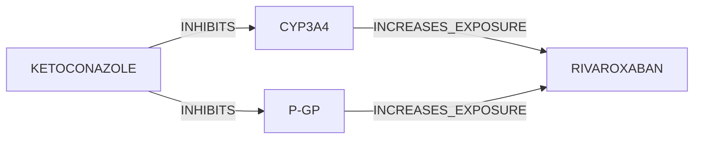
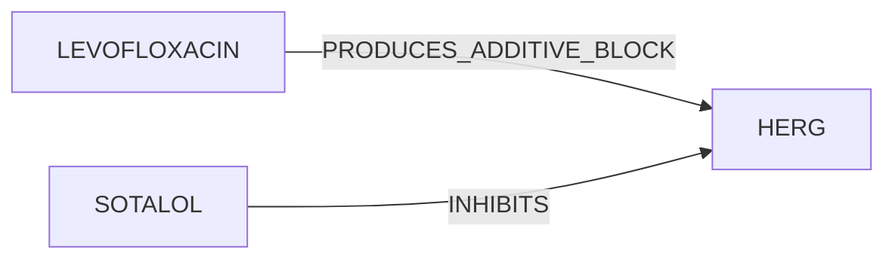
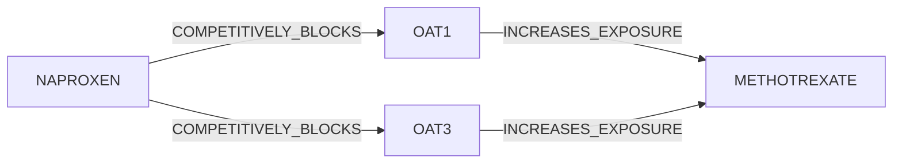
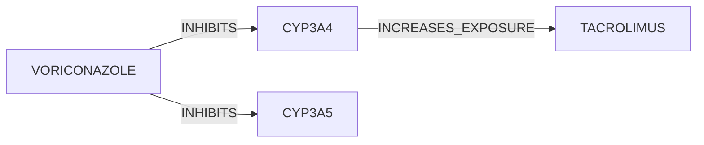
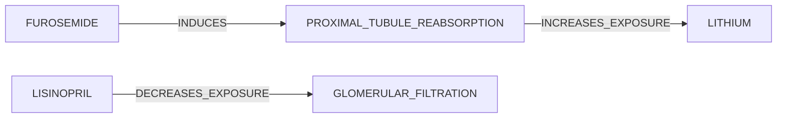

# TASK-01: Dual Elimination Shutdown: Rivaroxaban + Ketoconazole in Moderate Renal Impairment

## Ground Truth Causal Graph

# TASK-02: Prodrug Bioactivation Defeat: Clopidogrel + Omeprazole with Unknown CYP2C19 Genotype

## Ground Truth Causal Graph

# TASK-03: Electrolyte-Gated Proarrhythmic Cascade: Sotalol + HCTZ + Levofloxacin

## Ground Truth Causal Graph

# TASK-04: Renal Transporter Secretion Blockade: Methotrexate + Naproxen in Borderline Clearance

## Ground Truth Causal Graph

# TASK-05: Substrate Competition & Regulatory Dose Ceiling: Simvastatin + Amlodipine

## Ground Truth Causal Graph

# TASK-06: CYP3A4/5 Multi-Enzyme Collapse: Tacrolimus + Voriconazole with CYP3A5*3/*3 Genotype

## Ground Truth Causal Graph

# TASK-07: Stereoselective Enantiomeric Clearance Blockade: Warfarin + Metronidazole

## Ground Truth Causal Graph

# TASK-08: Renal Proximal Tubule Sodium-Mimic Synergy: Lithium + Lisinopril + Furosemide

## Ground Truth Causal Graph

# TASK-09: Safe Combination Control: Atorvastatin + Azithromycin

## Ground Truth Causal Graph

# TASK-10: Safe Combination Control: Warfarin + Ceftriaxone

## Ground Truth Causal Graph

